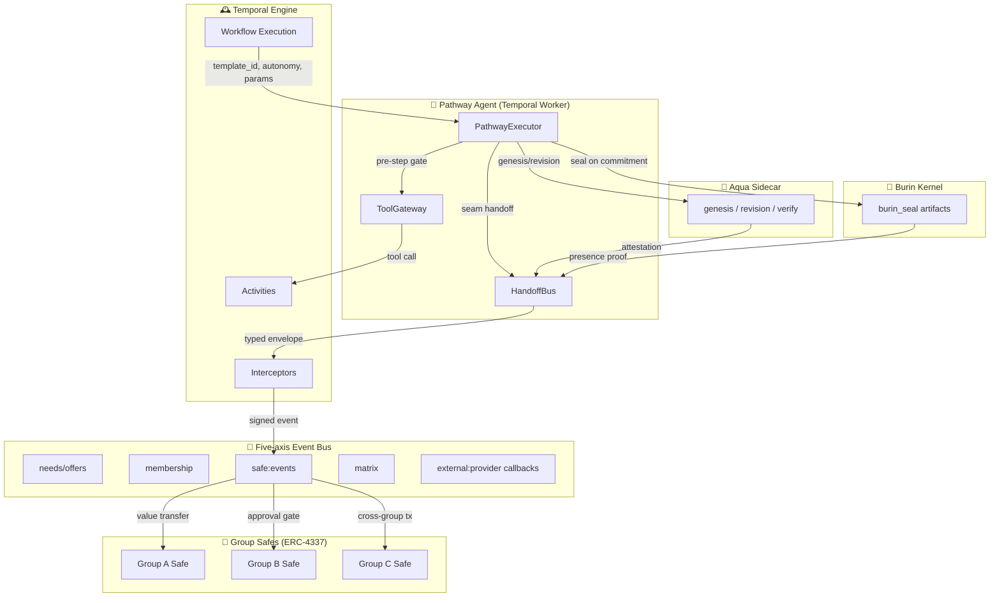

# Pathways × irl.coop: Integration Design Doc

> **Protocol draft v0.4 — working draft.**
>
> "We are building a global network of locally-governed, regenerative, skill-sharing communities."
> — Nicole Hemengway
>
> That sentence is the whole project in six words. But a network is only as strong as the connections between its nodes. When each community runs as its own Safe — when no platform sits above another, when each group governs its own workflows, its own members, its own data — then the act of *cooperating* becomes the hard part, not the easy part.
>
> Coordination across sovereign groups can't rely on a shared backplane, a central clearinghouse, or a broker to adjudicate disputes. The groups themselves have to be able to cooperate in ways that are **portable, provable, and composable** — where a pattern that works in one community can be picked up, verified, adapted, and recomposed in another without needing to check back with a central authority.
>
> That is what this integration delivers. Pathways (authored by DJ Thomson) provides the accountability layer that lets a field worker in a Detroit urban farming co-op hand a verified soil survey to a Portland climate resilience network, where it flows into a Mexico City dev guild's code review, where it becomes part of a cross-federation grant application — all with a cryptographic trail of who did what, when, where, and with what confidence.
>
> This document explains why that matters for the mission, why we chose to build it now, what becomes possible when multiple groups can cooperate autonomously across the full application stack, and how risk, escrow, and insurance flow through the system as a first-class concern rather than an afterthought.

---

## 1. Why this integration matters

### The problem: cooperation that dissolves after the work is done

Every group in the irl.coop ecosystem runs on the same fundamental tension: they need automation to operate at scale, but they can't trust a shared orchestrator. Their data lives in their own Safe, their workflows are their own to govern, their members hold each other accountable.

When the Detroit urban farming collective needs a soil quality assessment, and the Portland climate resilience network can provide one, and the Mexico City dev guild can help build the dashboard to display it — without Pathways, each of these is a separate coordination problem. A Matrix channel here, a shared spreadsheet there, a Safe proposal somewhere else. Someone sends a message, someone assigns a task, someone manually creates a ticket, and the trail of what happened — and why — dissolves once the task is marked "done." The pattern that Portland discovered, the one that actually worked for a seagrass survey in Casco Bay, stays locked in their channel history. Nobody in Detroit or Mexico City ever learns from it.

Temporal gives us durability — workflows that survive crashes and retries. But a Temporal workflow execution is, after the fact, just a sequence of activity logs. There's no portable proof of what was decided, no way for Portland to hand their proven process to Detroit without starting from scratch, no way to answer "who vouched for whom?" without a human digging through logs.

Pathways solves exactly this gap. It doesn't replace Temporal — it *complements* it. Pathways is an accountability layer for autonomous workflow execution: every run gets a stable identity (`pr_<hex>`), a full provenance trail, cryptographic attestation (via Aqua), and a typed handoff envelope at every seam where one agent's output becomes another's input. Where Temporal ensures the work gets done, Pathways ensures it gets done *in a way that can be proven, audited, forked, and selectively merged across group boundaries*.

### What this enables: cooperation at multiple levels across the stack

The real power of this integration emerges when you stop thinking about single groups and start thinking about nested, cooperating collectives. Consider a full-stack irl.coop scenario:

A community solar network in Portland wants to verify production data. A local food collective in Detroit needs a soil quality assessment. A dev co-op in Mexico City offers code review services. All three need to coordinate — the solar data informs the soil model, the code review ensures data integrity, and the soil assessment validates the community's impact claims for a federal grant.

Without Pathways, each of these is a separate coordination problem — a Matrix channel, a shared spreadsheet, a Safe proposal. With Pathways integrated into the irl.coop stack, each becomes a *pathway run*: a versioned template that can be forked, customized, and composed with other runs across group boundaries.

This changes what's possible at every layer of the stack:

**Across the app stack**, the five-axis event bus (needs/offers, membership, Safe events, Matrix messages, external provider callbacks) becomes the transport layer for typed `HandoffEnvelope`s. When a field worker in the Presence Passport app records a geospatial survey, that presence proof doesn't just land in a Matrix message — it becomes a sealed artifact in a pathway run, attested by Burin, and a HandoffEnvelope carrying `intent: peer:fetch_template` can automatically offer that template to any other group doing similar surveys. The signal doesn't get lost in chat noise. When the Transect Trust app needs to trigger a Barter Matching pathway, the event bus delivers a structured, signed, auditable envelope rather than a free-text request.

**Across group boundaries**, a group's Safe can autonomously execute a pathway at autonomy level A2 (headless execution with gate-profile enforcement) because the gate profile is itself a signed artifact — not a configuration file buried in someone's repo. When the pathway needs to cross into another group's domain (A3), the HandoffBus constructs a typed envelope that the peer group's ToolGateway validates against allowlists before any sub-run launches. No human needs to manually review each handoff; the chain of trust travels with the run. This is what makes autonomous cooperation at scale possible — every group's agents can act on behalf of their collective, but only within the bounds of pre-agreed, cryptographically-verifiable rules.

**Across time**, a pathway template that proved its worth in one context — say, a conservation grant quarter — can be forked, adapted, and re-attested in another. The lineage is cryptographically preserved via AquaTree revisions. This is how patterns propagate without a central platform: groups that have solved a problem publish their proved templates, and other groups can adopt, adapt, or ignore them. The soil survey pattern from Casco Bay becomes the template for every new urban farming assessment, improving with each fork while preserving the original's provenance.

### What this enables across the stack

The real power of this integration emerges when you stop thinking about single groups and start thinking about nested, cooperating collectives. Consider a typical irl.coop scenario: a community solar network wants to verify production data, a local food collective needs a soil quality assessment, and a dev co-op offers code review services. Without Pathways, each of these is a separate coordination problem — a Matrix channel, a shared spreadsheet, a Safe proposal. With Pathways integrated into the irl.coop stack, each becomes a *pathway run*: a versioned template that can be forked, customized, and composed with other runs across group boundaries.

This changes what's possible:

**Across the app stack**, the five-axis event bus (needs/offers, membership, Safe events, Matrix messages, external provider callbacks) becomes the transport layer for typed `HandoffEnvelope`s. When a field worker in the Presence Passport app records a geospatial survey, that presence proof doesn't just land in a Matrix message — it becomes a sealed artifact in a pathway run, attested by Burin, and a HandoffEnvelope carrying `intent: peer:fetch_template` can automatically offer that template to any other group doing similar surveys. The signal doesn't get lost in chat noise.

**Across group boundaries**, a group's Safe can autonomously execute a pathway at autonomy level A2 (headless execution with gate-profile enforcement) because the gate profile is itself a signed artifact — not a configuration file buried in someone's repo. When the pathway needs to cross into another group's domain (A3), the HandoffBus constructs a typed envelope that the peer group's ToolGateway validates against allowlists before any sub-run launches. No human needs to manually review each handoff; the chain of trust travels with the run.

**Across time**, a pathway template that proved its worth in one context — say, a conservation grant quarter — can be forked, adapted, and re-attested in another. The lineage is cryptographically preserved via AquaTree revisions. This is how patterns propagate without a central platform: groups that have solved a problem publish their proved templates, and other groups can adopt, adapt, or ignore them.

### The decision to integrate: why Pathways, and why now

This wasn't obvious from the start. irl.coop had already built Temporal workers, the five-axis event bus, Safe contracts, and Burin presence seals. Groups were transacting across boundaries. But something was missing — and that something wasn't a feature gap, it was a *provenance gap*. When a field worker's presence proof became a Safe event, when a Matrix message became a Safe proposal, when a needs/offer match became a cross-group barter — none of those threads tied back to each other in a verifiable way. Each was a disconnected moment in time.

The decision to integrate Pathways came from asking one question: **how do we make cooperation portable?** Not just between two groups, but between any two groups, at any depth of composition, with cryptographic guarantees that hold even when the groups don't trust each other?

Three converging forces made the answer clear:

**1. Trust without a broker.** irl.coop's groups are autonomous Safes. They don't want to trust a platform operator — that's the whole point. Pathways' archival model — templates as forkable, attributable, verifiable artifacts — means that the "platform" is just a peer running the same engine. No central catalog, no single authority. A group that has solved a problem publishes its proved template. Another group picks it up, verifies it offline with a Trust Key, forks it with their own adaptations, and the lineage is cryptographically preserved. This is what lets thousands of locally-governed communities coordinate without ceding sovereignty. It's also what makes the first force necessary but not sufficient — trust without a broker gets you started, but it doesn't get you to scale.

**2. Risk that scales.** As groups start transacting across boundaries, value moves through Safes with threshold-governed proposals. But threshold signatures alone don't capture the *risk profile* of a multi-step workflow — they don't tell you whether a three-day soil assessment is likely to complete on time, or whether the legal review sub-run has a history of disputes. Pathways' gate profiles and autonomy bands give us a way to reason about risk *before* value is on the line, and the insurance/contingency layer (Section 4) gives us a way to *price* that risk. Without this, larger-value cross-group transactions would require manual negotiation of escrow at every step — friction that would prevent the network from ever reaching critical mass.

**3. Composability without lock-in.** The Pathways spec defines `HandoffEnvelope` as a typed, validated, auditable message format for every seam — sub-run launch, external action, peer fetch. This maps directly to the irl.coop event bus's five axes. By building the integration at the HandoffBus layer, we preserve the ability for any group to run a Pathways-compatible engine independently — they don't need to be on the same Temporal cluster, the same Citus shard, or even the same Safe. A community running on a Raspberry Pi at a local node can launch a pathway sub-run in a city-wide co-op's domain, and the interface is the same. This is what prevents the network from calcifying into a platform — it stays federated at the protocol level, not the deployment level.

These forces don't just justify the integration — they *demand* it. Without portable, provable, composable cooperation, the vision of a global network of locally-governed communities is just a nice slogan. With it, it becomes a scalable reality.

### Expected outcomes: what becomes possible

We expect four concrete outcomes from the integration, each one building toward the broader mission of creating a global network of locally-governed, regenerative, skill-sharing communities:

**1. Groups can autonomously coordinate multi-party transactions** without manual intervention at every step. A3-level pathways cross Safe boundaries with auditable handoffs, while A0–A2 pathways execute within a group's Safe with thresholds. This is how locally-governed communities can coordinate at the scale of regions or nations without ceding sovereignty to a central authority. The Portland solar co-op can commission a soil assessment from the Detroit food collective, which can trigger a code review from the Mexico City dev guild — all without a single meeting, because the trust, risk, and accountability are encoded in the pathway run itself.

**2. Cross-group value transfer becomes provable.** Every barter, grant, or service exchange carries an embedded insurance profile derived from historical pathway runs, enabling dynamic escrow calculation rather than static hold periods. This is how a $500 design exchange gets the right amount of skin in the game — not too little to be meaningful, not so much that it freezes capital.

**3. Patterns propagate organically.** The Trust Key technique (co-authored by DJ Thomson and Cameron Sajedi) provides a portable provenance root — any group can verify, offline, that a pathway run's attestation chain is valid. This eliminates the need for a central clearinghouse. A co-op that solved wastewater management in their neighborhood can hand their proved template to another co-op 300 miles away, and the recipient can verify every step without phoning home.

**4. Cooperation itself becomes a competitive advantage.** As more groups join the federation and contribute proved templates, aggregate risk profiles decrease and larger-scale transactions become possible. The more participants, the more ambitious the cooperative can be. This is the multiplier effect — when the climate resilience co-op in Portland and the urban farming collective in Detroit and the open-source dev guild in Mexico City can all run verified workflows against each other's proven patterns, the total risk goes down and the scope of what they can jointly accomplish goes up.

---

## 2. Architecture: How Pathways fits into irl.coop

### The core mapping

The integration isn't a replacement — it's a layering. Pathways provides the accountability substrate; irl.coop provides the durability and value transport. Here's how the major components map:

```
Pathways Layer          ↔   irl.coop Layer
──────────────────────────────────────────────
PathwayRun              ↔   Temporal WorkflowExecution
  (autonomy: A0-A3)     ↔     (Safe threshold gate)
PathwayExecutor         ↔   Temporal Worker
  (per-run, dispatch)   ↔     (per-workflow, task routing)
ToolGateway             ↔   Temporal Activity / Interceptor
  (R2/R4/R5/R6)         ↔     (Budget, capability, halt)
HandoffBus              ↔   Five-axis Event Bus
  (typed envelopes)     ↔     (needs/offers/membership/safe/matrix)
Aqua attestation        ↔   Safe-signed events
  (proof of lineage)    ↔     (proof of value flow)
Burin seal              ↔   GPS-tagged, timestamped commits
  (presence proof)      ↔     (geospatial + temporal anchoring)
```

### The integration diagram



### How a pathway run launches

When a group's Safe receives a "start pathway" signal, Temporal launches a `PathwayRunWorkflow`. The workflow ID is the `pr_<hex>` from Pathways — a stable identifier that can be referenced, attested, and audited for the lifetime of the run. From there, the workflow:

1. Receives the template (`pw_<hex>`) and runtime parameters
2. Loads the gate profile from the template, resolves the effective autonomy (launch override ∩ `max_autonomy`)
3. Runs the launch gate — checks practice profile resolution, register minimums, escalation rule
4. Spawns the PathwayExecutor (as child activities or a single long-running activity)
5. At each step, calls `ToolGateway.pre_step_gate(step, phase)` before any tool invocation
6. At each seam (sub-run launch, external call, peer fetch), calls `HandoffBus.build_envelope(intent, target, params)`
7. Appends provenance, step executions, and handoff audits as Temporal workflow history + DB rows
8. On completion, requests an Aqua run-level attestation from the sidecar
9. Optionally creates a derivative document (linked to the Safe's claim)

### The HandoffBus as the event bus adapter

The five-axis event bus already has typed channels: needs/offers, membership, Safe events, Matrix messages, external callbacks. The HandoffBus sits on top of this transport layer as the *contract layer* — it ensures that every message crossing a group boundary conforms to a typed `HandoffEnvelope` schema before it's delivered.

This is more than a formatting change. It's what stops the event bus from degrading into another chat channel. Without the HandoffBus, a workflow step that needs to reach out to another group sends raw text into Matrix or a raw event onto the bus. The receiving group has to interpret intent, validate the sender, and decide whether to act — all manually. With the HandoffBus, that same handoff is a structured, signed, auditable envelope that carries a verifiable reference to the source pathway run, the step that produced it, and the cryptographically signed attestation of the sender. The receiving group's ToolGateway can validate the envelope against its allowlists in milliseconds — no human in the loop.

A `HandoffEnvelope` looks like this:

```yaml
handoff:
  envelope_version: "1.0"
  intent: <closed_enum>          # e.g. verify_claims, escalate_to_partner, send_message
  target: <typed_target>         # subrun:Legal.Research.PrimarySourcesDeep | channel:slack/... | peer:did:key:...
  params:                        # validated against per-intent JSONSchema
    jurisdiction: "CA"
    citation_ids: [...]
  event_text: "<raw upstream text>"  # wrapped as DATA, never as steering
  source_run_id: pr_<hex>
  source_step_order: <int>
  signed_by: "did:key:..."
  signed_at: <iso8601>
```

The HandoffBus maps Pathways intents to bus axes:

| Handoff intent | Maps to bus axis | Example |
|---|---|---|
| `pathway:launch_subrun` | needs/offers | "I need a Legal.Research.PrimarySourcesDeep run" → offered by any group running that template |
| `offer:match` | needs/offers | Group A offers a "weaving" loop → Group B's pathway consumes it |
| `safe:proposal` | safe:events | Pathway step that moves value → creates a Safe proposal |
| `human:gate` | membership | Non-delegable act → triggers membership approval flow |
| `matrix:message` | matrix | External communication → typed envelope to channel/group |
| `peer:fetch_template` | needs/offers | Fetch a forked template from a peer DID |

Every envelope is validated against the template's gate profile before the downstream agent is invoked. Free text is wrapped in a labeled data block — never injected as steering. An append-only audit trail records every accept/reject/halt event with signature verification.

### Gate profiles as the Safe threshold bridge

The escalation rule on each gate profile maps to the Safe's threshold model:

| Autonomy | Gate requirement | Safe threshold |
|---|---|---|
| A0 | R1 + human reads output | 1-of-1 (single human) |
| A1 | R1 + R6 (human_gate on commits) | 2-of-3 (group consensus on outbound) |
| A2 | R1 + R2 + R3 + R4 + R5 | Threshold-gated (no human in loop during execution, but Safe must have signed the gate profile) |
| A3 | All six registers | Multi-Sig + Burin presence proof + Aqua attestation required |

### A note on the run hypergraph

Pathways treats pathway runs as a directed acyclic hypergraph — each run can spawn child sub-runs, and every edge is a provenance link recorded both in the database (`PathwayRunSource` table with `role="subrun"`) and in the AquaTree. This is what makes recursive composition possible: a pathway run isn't just a flat sequence of steps, it's a graph where each node can branch into another full pathway run.

For irl.coop, this matters because cross-group transactions are inherently multi-layered. A conservation grant quarter might contain a sub-run for soil testing, a sub-run for community consent verification, and a sub-run for financial disclosure review — each of which might be a template forked from a different group. The run ID `pr_<hex>` provides a stable, verifiable anchor for each of these, and the hypergraph ensures the aggregate trust profile of a parent run includes the trust profiles of all its children.

### The Trust Key technique

Co-authored by DJ Thomson and Cameron Sajedi, the Trust Key technique provides a portable provenance root that any relying party can verify offline — no vendor login, no platform dependency. It issues a cryptographic root key that binds the entire context graph (PathwayRuns, seals, attestations, artifacts) and produces dimensional deep links scoped by registry-aligned parameters (composite_domain, capability, grant_id, location, time, etc.).

For irl.coop, this means a group can hand another group a Trust Key for a completed pathway run, and the recipient can verify the entire provenance chain on their own device. When that Trust Key is embedded in a Safe-signed event on the event bus, it becomes an auditable bridge between the value layer (Safe transactions) and the attestation layer (Aqua/Burin).

---

## 3. Risk, Escrow, and Insurance: Pricing Cooperation

### The insight that started it all

Having provenance, attestation, and gate profiles doesn't automatically tell you how much capital to lock up when two groups enter a barter. We needed a way to *learn* from past pathway runs and *predict* the risk of future ones — not as a spreadsheet calculation, but as a first-class artifact that travels with the pathway itself.

The solution: derive an **insurance profile** from every **signed weave** (a completed pathway run with full Aqua attestation chain). The insurance profile encodes per-step risk scores, failure-mode contingencies, and a recommended escrow amount — all of which are themselves Pathways templates that can be forked, verified, and peered across groups.

### Per-step risk signals

Each step in a pathway run produces risk signals that feed into the aggregate score:

| Signal | Source | Weight |
|---|---|---|
| Model provider risk score | From `model_provider_risk_index` table (external provider = higher risk) | 25% |
| Budget utilization ratio | `tokens_used / budget_allocated` — high ratio = pressure | 20% |
| Step duration variance | `actual / expected` — high variance = unpredictability | 20% |
| Confidence score | LLM self-assessment or downstream verification confidence | 15% |
| Tool capability breadth | Number of distinct tools invoked — more = more attack surface | 10% |
| Seam crossings | Steps that initiated external actions (browsing, safe:proposal, peer:fetch) | 10% |

The **aggregate risk score** for a pathway template is a weighted average of historical run data, updated after each execution. Templates with no history default to their autonomy band's baseline:

- A0 → 0.15
- A1 → 0.35
- A2 → 0.60
- A3 → 0.80

### Escrow calculation

Given a pathway template with risk score `R`, the escrow amount is:

```
escrow = base_value × (1 + R × risk_multiplier)

where:
  base_value = the exchange value the pathway facilitates
  risk_multiplier = configurable per group (default: 0.5)
```

**Example:** Group A and Group B enter a barter — Group A provides 10 hours of developer time (valued at $500), Group B provides design services. The pathway `Offer.Match.Barter.A2` has a historical risk score of 0.52. The escrow is:

```
escrow = 500 × (1 + 0.52 × 0.5) = 500 × 1.26 = $630
```

Both groups lock $630 in the Safe contract. If the pathway completes successfully, the escrow is released to the fulfilling party minus fees. If it fails or is disputed, the escrow covers the contingency.

### Contingency profiles

From the signed weave, the system also generates **contingency profiles** — pre-composed "what if" pathways for each failure scenario:

```yaml
contingency_profile:
  pathway: Offer.Match.Barter.A2
  risk_score: 0.52
  failure_modes:
    - mode: partial_delivery
      probability: 0.18
      contingency_pathway: Offer.Dispute.PartialDelivery.A1
      required_escrow: 0.30  # 30% of base value
    - mode: non_delivery
      probability: 0.08
      contingency_pathway: Offer.Dispute.NonDelivery.A1
      required_escrow: 0.80  # 80% of base value
    - mode: quality_dispute
      probability: 0.22
      contingency_pathway: Offer.Dispute.Quality.A1
      required_escrow: 0.50
  total_required_escrow: 1.0  # sum of worst-case scenarios
```

The contingency pathways are themselves Pathway templates with their own gate profiles and autonomy bands. The HandoffBus routes dispute events to the appropriate pathway automatically — when a step fails or a deliverable is disputed, a HandoffEnvelope with `intent: dispute:escalate` triggers the contingency pathway, and the Safe releases escrow according to the pre-negotiated profile.

### Learning from outcomes

After each pathway run — successful or failed — the PathwayExecutor calls back to the risk engine:

```python
risk_engine.update_from_run(
    template_id="pw_a3f2c1...",
    run_id="pr_4b1e8d...",
    outcome="completed",  # or "failed", "halted"
    actual_vs_expected_budget=budget_ratio,
    step_durations=durations,
    confidence_scores=scores,
    dispute_occurred=False
)

# Bayesian updating:
# New score = (prior_weight × old_score + run_weight × new_signal) / (prior_weight + run_weight)
# Prior weight decays over time to let old evidence fade
```

Risk scores and contingency profiles are stored as Pathways artifacts — themselves Aqua-attested and forkable. A group can "subscribe" to improvements in the risk model by peering with other groups that have run the same template. Over time, the federation develops a shared sense of which patterns are safe and which aren't, without any central authority dictating it.

### Burin seals on risk artifacts

Every insurance profile derived from a signed weave is sealed with Burin — `commitment ‖ [cell] ‖ [time]` — anchoring when and where the risk calculation was performed. A group's Safe can verify the seal offline: the escrow amount, the contingency pathways, and the risk score are all cryptographically bound to a specific geographic and temporal context. No external oracle is needed to confirm that the insurance terms were agreed to before the pathway launched.

---

## 4. The missing piece: Recursive Value Propagation

### What we realized after running this in production

Pathways and irl.coop both handle single-layer coordination beautifully. A group runs a pathway → the pathway does work → provenance is recorded → escrow is settled. But what happens when a pathway's *sub-run* is itself a multi-party transaction that needs its own insurance? And what happens when that sub-transaction is consumed by another pathway that crosses yet another group boundary?

The answer is **recursive value propagation**: every pathway step that consumes an offer or produces a deliverable carries an embedded insurance/contingency profile that propagates upward through the provenance chain. When you launch a parent pathway, the total escrow isn't just `base_value × (1 + R × multiplier)` — it's the **sum of all nested insurance profiles** across the entire sub-run hypergraph.

```yaml
# Example: A complex barter pathway with nested sub-runs
pathway: Group.Project.Deliverable.A2
escrow_breakdown:
  base_value: 5000
  risk_score: 0.42
  sub_run_insurance:
    - child_pathway: Offer.Match.Barter.A2
      child_run_id: pr_4b1e8d
      escrow_allocated: 630
      contingency_available: 630
    - child_pathway: Offer.Dispute.Quality.A1
      child_run_id: pr_7c3a2f
      escrow_allocated: 250
      contingency_available: 250
  aggregate_risk: 0.58  # elevated by child pathways
  total_escrow: 7640  # base + risk buffer + all child insurance
```

This creates a **fractal structure**: every pathway run, at any depth, carries a complete risk profile that includes the risk profiles of all its descendants. The HandoffBus enforces that no sub-run can launch without a valid `insurance_profile` being embedded in its `HandoffEnvelope`. The Safe contract checks the aggregate escrow before releasing funds.

### Why this is the missing piece — and what it unlocks

When multiple groups can each run autonomous pathways, and those pathways can compose into recursive hypergraphs with embedded insurance, something shifts. It's no longer a question of "do I trust this other group?" — it's a question of "what does the signed weave say about the risk profile of this transaction chain, and is the escrow sufficient to cover every failure mode?"

This is what makes cooperation scale:

1. **Composability without blind trust** — when Group A's pathway launches sub-runs in Group B's and Group C's domains, each sub-run's insurance profile is visible and verifiable. Group A doesn't need to trust Group B's risk model — it sees the signed weave and the embedded insurance terms, and its own Safe enforces the aggregate.

2. **Emergent cooperation** — small groups can bundle their insurance profiles into larger pathways. A group with a low risk score (because they have a strong track record) can subsidize a newer group's escrow requirements by providing a "risk guarantee" pathway that runs parallel. The aggregate risk decreases.

3. **Cooperation as a superpower** — the total escrow for a federation-wide project becomes `base_value × (1 + aggregate_risk × multiplier)` where `aggregate_risk` *decreases* as more groups join and provide risk guarantees. This is the mathematical basis for "cooperation as a superpower" — the more participants, the lower the per-capita risk, and the more ambitious the projects the federation can undertake.

### The cross-stack implication

The real value of recursive value propagation reveals itself when you look across the full irl.coop stack:

- **Presence Passport** (field workflows) generates Burin-sealed presence proofs that feed into a **Conservation Grant Quarter** pathway in Transect Trust, which in turn feeds into a **Barter Matching** pathway that exchanges conservation data for design services across group boundaries. Each layer carries its own insurance profile, and the aggregate is verifiable at every Safe on the chain.

- **Needs/offers** on the event bus aren't just messages — they're invitations to launch pathway runs. The HandoffBus ensures that when a need is posted, the responder's capability is attested (via a Trust Key), the intended pathway is pre-vetted by its insurance profile, and the Safe can lock the right amount of escrow before the first step fires.

- **Matrix messages** become structured handoff envelopes rather than free-text requests. A field worker's "I found three seagrass patches" becomes a `HandoffEnvelope` with `intent: peer:fetch_template`, triggering an automated assessment pathway that other groups can pick up, fork, and contribute back.

This is the vision: groups of people and their AI agents, deeply interacting in controlled but autonomous ways, making cooperation a superpower that rivals nation-states.

---

## 5. Implementation plan

The integration unfolds in four phases, each adding a layer of autonomy and cross-group capability:

### Phase 1: Bridge (months 1-3)

Get Pathways semantics into Temporal and talking to the event bus.
- [ ] Map PathwayRun → Temporal Workflow (workflow ID = `pr_<hex>`)
- [ ] Implement ToolGateway as a Temporal Activity interceptor
- [ ] Translate HandoffBus intents to event bus channels
- [ ] Run first pathway at A0 with manual escrow setup

### Phase 2: Autonomy (months 4-6)

Wire up trust — attestation, presence, and human-in-the-loop gates.
- [ ] Wire up the launch gate (R1 cold-start, escalation rule)
- [ ] Connect to Aqua sidecar for genesis attestation
- [ ] Run first pathway at A1 (human_gate on Safe proposals)
- [ ] Implement Burin seals on geospatial pathway outputs

### Phase 3: Federation (months 7-9)

Go live across group boundaries.
- [ ] Implement the HandoffBus peer fetch protocol
- [ ] Run first cross-boundary pathway at A3
- [ ] Deploy the insurance profile generator as a meta-pathway
- [ ] Test recursive value propagation with 3-group barter

### Phase 4: Recursive coop (months 10-12)

Scale the pattern across the federation.
- [ ] Launch the risk-guarantee marketplace
- [ ] Enable dynamic escrow calculation across the federation
- [ ] Publish the first federation-wide contingency profile
- [ ] Measure cooperation-as-superpower metrics

---

## 6. Risks and mitigations

| Risk | Mitigation |
|---|---|
| **Pathways spec changes** — The spec is v1.1.0 and evolving rapidly. | Pin to the RIS 1.1.0 normative sections. Meta-pathways for spec self-provenance will track changes. |
| **Temporal workflow ID collisions** — Multiple groups might use the same template. | Namespace pathway run IDs with group DID: `pr_<group_hash>_<hex>` |
| **Gas costs on Safe transactions** — Every HandoffBus envelope costs gas. | Bundle multiple envelopes per transaction during low-activity windows. |
| **Trust in risk scores** — Groups might game the risk model. | Risk scores are Aqua-attested and forkable. A group with a manipulated score loses peering trust. |
| **Insurance over-allocation** — Escrow requirements might be too high, blocking small trades. | Start with A0/A1 pathways for small value. The risk-guarantee marketplace (Phase 4) is designed to lower escrow floors. |

---

## 7. Glossary

| Term | Definition |
|---|---|
| **Pathway template** | A versioned recipe (`pw_<12-hex>`): identity triple (Domain, Subdomain, Action), steps, contracts, gate profile, license. Think of these as the new "workflow type" — but forkable, attributable, and mergable across groups. |
| **Pathway run** | One execution of a template (`pr_<12-hex>`): concrete inputs, step outputs, provenance trail, attestations. This is what we've been losing — every Temporal workflow execution is a black box after it finishes. |
| **Signed weave** | A completed pathway run with full Aqua attestation chain — the provenanced artifact used for insurance derivation. |
| **Autonomy band** | A0–A3; controls how much autonomous decision-making a pathway run is trusted with. Maps directly to irl.coop's "group needs approval vs agent can act" problem. |
| **Gate profile** | Six registers (R1–R6) of restraint on a template; enforced at launch, pre-step, and seam choke points. The six registers are: R1 (prompt/workflow contract), R2 (tool capability), R3 (code at seams), R4 (economic budget), R5 (temporal halt), R6 (contextual phase). |
| **ToolGateway** | Single choke point that every agent tool call routes through — enforces R2/R4/R5/R6 before any tool fires. In irl.coop, this becomes a Temporal Activity interceptor. |
| **HandoffBus** | Constructs typed `HandoffEnvelope`s at every seam (sub-run launch, external action, peer fetch) — validated against allowlists, audit-trail appended, free text wrapped as data not steering. Maps to the five-axis event bus. |
| **HandoffEnvelope** | The typed, validated, auditable message format: `intent`, `target`, `params`, `event_text` (wrapped as data), `source_run_id`, `source_step_order`, `signed_by`, `signed_at`. |
| **Aqua Protocol** | Cryptographic attestations over templates and runs — tamper-evident, verifier-portable, DID-signed. Produces the genesis/revision/verify chain for every pathway. |
| **Burin Protocol** | Seals over `commitment ‖ [cell] ‖ [time]` — presence attestation, consensus-free, offline-verifiable. For irl.coop, seals geospatial + temporal context onto pathway outputs. |
| **Trust Key** | DJ Thomson & Cameron Sajedi's technique for issuing a portable provenance root — a single key that binds the entire context graph, verifiable offline by any relying party. |
| **Run hypergraph** | The directed acyclic graph of pathway runs and their sub-run relationships — every child run links back to its parent via `PathwayRunSource` edges, and the aggregate risk profile propagates upward. |
| **Recursive value propagation** | The model where every pathway step carries embedded insurance profiles that sum up through the provenance chain. The missing piece that makes cross-group cooperation scalable. |
| **Risk score** | A 0–1 value derived from historical pathway run data (model risk, budget pressure, duration variance, confidence, tool breadth, seam crossings), used to calculate escrow requirements. |
| **Contingency profile** | A set of failure-mode pathways with pre-allocated escrow, auto-launched on dispute via HandoffBus `intent: dispute:escalate`. |
| **Weave** | irl.coop term: a people+AI coordination artifact (needs/offers, membership commitments, multi-party transactions). When signed and attested, it becomes a "signed weave." |
| **Weaving** | The noun form of "loops" — the act of connecting needs and offers into productive pathways that generate mutual value. |

---

## 8. References

1. **Pathways RIS spec** — `PATHWAYS_REFERENCE_v1.1.0.md` (normative; includes §4.8.7 on HandoffBus, §4.8.8 on capability profiles, §4.8.9 on phase declarations)
2. **Pathways architecture** — `PATHWAYS_ARCHITECTURE_v1.1.0.md` (descriptive; includes §8 on sub-pathways and the run hypergraph)
3. **Burin × Pathways README** — `PATHWAYS_README.md` (workspace overview)
4. **Trust Key technique** — `burin-pathways/techniques/TRUST_KEY_TECHNIQUE.v1.md` (portable provenance root by DJ Thomson & Cameron Sajedi)
5. **Aqua Protocol plan** — `docs/aqua-protocol-pathways-integration.plan.md` (cryptographic attestations layer)
6. **irl.coop stack context** — persistent memory notes (Temporal workers, five-axis event bus, Safe contracts, Burin presence layer)
7. **irl.coop architecture** — `next-js-portfolio/src/app/blog/posts/irl-coop-architecture-deep-dive.mdx` (six-layer architecture, Mobile Edge Nodes)
8. **irl.coop settlement system** — `next-js-portfolio/src/app/blog/posts/irl-coop-cooperative-settlement-system-specification.mdx` (escrow, sponsors, risk management)
9. **irl.coop weaving philosophy** — `next-js-portfolio/src/app/blog/posts/irl-coop-weaving-polycentric-collectives.mdx` (polycentric governance, trust without a broker)